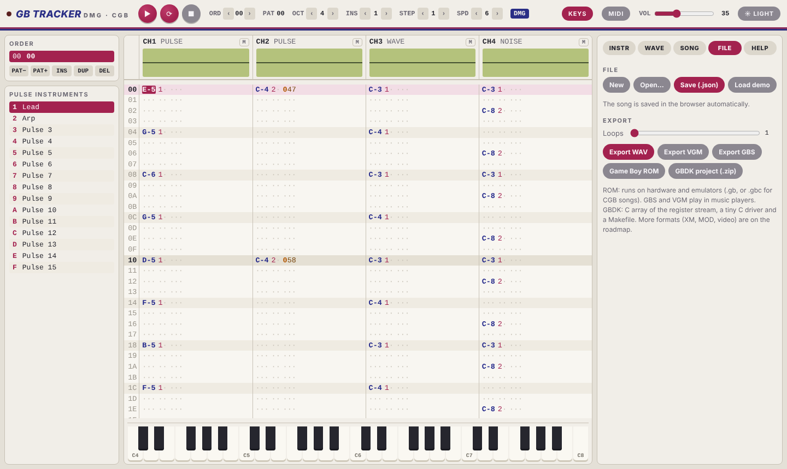
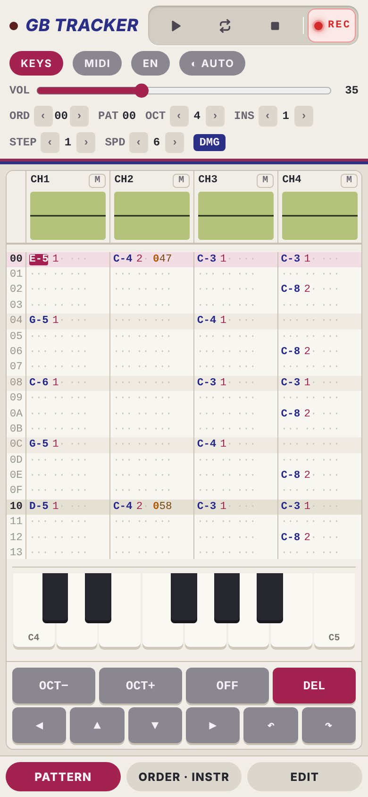

# GB Tracker manual

GB Tracker is a music tracker for the Nintendo Game Boy that runs in the browser, on a desktop with a keyboard
and on phones and tablets with touch. Everything you hear is produced by an emulation of the Game Boy's sound
hardware (the APU), driven by the same register writes a sound driver makes on a real console. A song that
sounds right in the tracker sounds the same on hardware, in the exported ROM and in your own GBDK game.

**Open the tracker:** https://wirehack7.github.io/Gameboy-Tracker/

## Contents

- [Quick start](#quick-start)
- [The screen](#the-screen)
- [Channels and the Game Boy sound hardware](#channels-and-the-game-boy-sound-hardware)
- [Patterns and the pattern editor](#patterns-and-the-pattern-editor)
- [Entering notes and values](#entering-notes-and-values)
- [Keyboard shortcuts](#keyboard-shortcuts)
- [Touch and phone use](#touch-and-phone-use)
- [On-screen piano and MIDI keyboards](#on-screen-piano-and-midi-keyboards)
- [Song structure: order list and patterns](#song-structure-order-list-and-patterns)
- [Instruments](#instruments)
- [Waveforms](#waveforms)
- [Effects](#effects)
- [Speed and tempo](#speed-and-tempo)
- [DMG and Game Boy Color mode](#dmg-and-game-boy-color-mode)
- [Playback, scopes and mixing](#playback-scopes-and-mixing)
- [Saving and loading](#saving-and-loading)
- [Exporting](#exporting)
- [Using the music in a GBDK game](#using-the-music-in-a-gbdk-game)
- [Tips and hardware quirks](#tips-and-hardware-quirks)
- [Not available yet](#not-available-yet)

## Quick start

1. Open the tracker. The first visit loads a short demo song; press **Space** (or the round **▶** button) to
   hear it. Browsers only allow sound after a click or key press, so the first press also starts the audio.
2. Click a cell in the pattern. Coloured columns are note, instrument, volume, effect and effect parameter.
3. With the cursor in a note column, play notes on your computer keyboard: the bottom letter row
   (`Z S X D C V G B H N J M`) is one octave like a piano, the row above (`Q 2 W 3 E R 5 T 6 Y 7 U`) the next
   octave. Each note is written into the pattern and the cursor moves down by the edit step.
   No computer keyboard? Use the on-screen piano under the pattern, or plug in a MIDI keyboard and press
   **MIDI**.
4. Change the current octave with `[` and `]`, the instrument with the **INS** arrows in the toolbar.
5. Open the **INSTR** tab on the right to shape the sound, **FILE** to save your song or export it.

Your work is saved in the browser automatically after every change.

## The screen



**Toolbar (top)**

| Element | What it does |
| --- | --- |
| LED | Lights up while the song plays. |
| ▶ | Play the song from the start of the current order position. |
| ⟳ | Loop the current pattern, starting at the cursor row. |
| ■ | Stop. |
| ● | Record mode on or off (also `Esc`). When it is off, notes are only played and the pattern is not changed, see [Record mode](#record-mode). |
| ORD | Current position in the order list (hex). The arrows step through the song. |
| PAT | Number of the pattern at that position (hex). |
| OCT | Octave for note entry (2–8). |
| INS | Instrument used for new notes (1–F). |
| STEP | Edit step: how many rows the cursor moves after an entry (0–16). |
| SPD | Song speed in ticks per row (1–31), see [Speed and tempo](#speed-and-tempo). |
| DMG / GBC | Hardware model of the song (change it in the SONG tab). |
| KEYS | Shows or hides the on-screen piano under the pattern. |
| MIDI | Turns MIDI input on or off. While on, it shows the number of connected inputs. |
| VOL | Master volume of the browser playback (default 35). Exports are not affected. |
| Language | Language of the interface: English, Deutsch, Español, Français. The first visit picks the browser's language; your choice is remembered. This manual is in English. |
| Theme | Cycles between automatic (follows the system), light and dark. |

**Left sidebar**

- **ORDER**: the order list, the sequence of patterns that makes up the song.
  See [Song structure](#song-structure-order-list-and-patterns).
- **INSTRUMENTS**: the 15 instruments of the channel type under the cursor (pulse, wave or noise).
  Clicking one selects it for note entry and opens it in the INSTR tab.

**Centre**

- **Channel header** with an oscilloscope and a mute button (**M**) for each of the four channels.
- **Pattern** with one row per line and four channels side by side.
- **Piano** under the pattern (toggle with **KEYS**), see [On-screen piano](#on-screen-piano-and-midi-keyboards).

**Right sidebar tabs**

| Tab | Content |
| --- | --- |
| INSTR | Instrument editor. |
| WAVE | Waveform editor for the wave channel. |
| SONG | Title, author, DMG/GBC, speed, pattern tools, follow playback. |
| FILE | New, open, save, demo and all exports. |
| HELP | Short reference of keys and effects, and a link to this manual. |

On tablets the layout switches to two columns, on phones to separate views (see
[Touch and phone use](#touch-and-phone-use)).

## Channels and the Game Boy sound hardware

The Game Boy has four sound channels, and the tracker has exactly these four:

| Channel | Type | Registers | What it can do |
| --- | --- | --- | --- |
| CH1 | Pulse with sweep | NR10–NR14 | Square wave with 4 duty cycles, volume envelope, length counter, hardware frequency sweep. |
| CH2 | Pulse | NR21–NR24 | Like CH1, without sweep. |
| CH3 | Wave | NR30–NR34 | Plays a user-drawn waveform of 32 samples × 4 bits. 4 volume levels (mute, 100 %, 50 %, 25 %). |
| CH4 | Noise | NR41–NR44 | Pseudo-random noise from a 15-bit or 7-bit shift register (LFSR). Drums, hi-hats, effects. |

Mixing (NR50, NR51) and the power switch (NR52) are shared. Each channel can be sent to the left, right or both
outputs, see effect [8xx](#effects).

Every channel uses instruments of its own type: CH1 and CH2 use pulse instruments, CH3 wave instruments, CH4
noise instruments. Instrument 3 on CH1 and instrument 3 on CH3 are two different instruments.

The note range is **C-2 to B-8** (65 Hz to about 7.9 kHz), seven octaves. C-2 is the lowest C the pulse
channels can play. On the noise channel, notes choose a noise clock setting (NR43 shift and divisor) whose rate
is close to the note's pitch, so higher notes give brighter noise; the exact pitch of noise is not musical.

## Patterns and the pattern editor

A pattern has 64 rows. Every row has a cell for each channel, and every cell has five columns, colour coded:

| Column | Example | Range | Meaning |
| --- | --- | --- | --- |
| Note | `C-4`, `A#5`, `===` | C-2 … B-8 | The note to play. `===` is note off: the channel is silenced. |
| Instrument | `1` | 1–F | Instrument for this note. Empty: keep the channel's current instrument. |
| Volume | `C` | 0–F | Start volume of the note (overrides the instrument's volume). |
| Effect | `4` | 0–F | Effect command, see [Effects](#effects). |
| Parameter | `37` | 00–FF | Two hex digits for the effect. |

Empty columns are shown as dots. Rows are shaded every 4 rows (beat) and every 16 rows (bar). The row being
played is highlighted in red, the cursor row in a lighter tint.

Row numbers, order positions, pattern numbers and effect parameters are hexadecimal, as in most trackers.

## Entering notes and values

### Record mode

The red **●** button next to Stop (or `Esc`) switches record mode on and off. It is on by default, and the
tracker remembers the setting.

- **On:** notes and values are entered into the pattern as described below.
- **Off:** the tracker becomes an instrument to jam on. Notes from the computer keyboard, the on-screen piano,
  the keypad and MIDI are only played, on every column, and nothing in the pattern changes: hex digits,
  `Delete`, note off and `Insert` are ignored. The cursor turns grey so you can see that editing is off.
  Moving the cursor and playback work as usual, so you can play along with the song.

### Entering values

- **Notes:** move the cursor to a note column and press a note key (see below), or tap a key on the on-screen
  keypad. The note is written together with the currently selected instrument, and you hear it.
  `1` (or the key left of `1`, `` ` ``) writes a note off `===`.
- **Instrument, volume, effect, parameter:** move the cursor to that column and type a hex digit `0`–`9`, `A`–`F`.
  In the instrument column `0` clears the instrument. Typing a parameter digit into a cell without an effect
  sets the effect to `0`, so type the effect digit first.
- **Clear:** `Delete` or `Backspace` clears the field under the cursor. On the note column it clears note,
  instrument and volume together.
- **Edit step:** after each entry the cursor moves down by STEP rows. With STEP 0 it stays where it is, which
  is handy for trying values.
- **Insert / delete rows:** `Insert` pushes the current channel down by one row from the cursor (the last row
  falls off). **Delete row** in the SONG tab pulls the rows below up. Both only affect the channel under the
  cursor.
- **Transpose:** the SONG tab has buttons to move all notes of the current channel in the current pattern up or
  down by one semitone.

### Note keys

The note keys use the physical position of the keys, so they work the same on QWERTY, QWERTZ and AZERTY
keyboards (on QWERTZ the bottom-left note key is `Y`).

```
 upper row (octave + 1):   2 3   5 6 7   9 0
                          Q W E R T Y U I O P
 lower row (octave):       S D   G H J   L ;
                          Z X C V B N M , . /
```

The lower row starts at C of the current octave (`Z` = C, `S` = C#, `X` = D, … `M` = B, `,` = C one octave up),
the upper row starts one octave higher (`Q` = C, `2` = C#, … `P` = E two octaves up).

## Keyboard shortcuts

| Key | Action |
| --- | --- |
| Note keys | Enter a note (note column) |
| `1` or `` ` `` | Note off `===` (note column) |
| `0`–`9`, `A`–`F` | Enter a hex digit (instrument, volume, effect and parameter columns) |
| `↑` `↓` | Previous / next row (wraps around) |
| `←` `→` | Previous / next column, continues into the neighbouring channel |
| `Tab` / `Shift+Tab` | Next / previous channel |
| `Page Up` / `Page Down` | 16 rows up / down |
| `Home` / `End` | First / last row |
| `Space` | Play song / stop |
| `Shift+Space` | Loop the current pattern from the cursor row / stop |
| `Esc` | Record mode on / off |
| `Delete`, `Backspace` | Clear field |
| `Insert` | Insert an empty row in the current channel |
| `[` or Numpad `−` | Octave down |
| `]` or Numpad `+` | Octave up |

Shortcuts are ignored while a text field (song title, instrument name, …) has the focus, and when `Ctrl`, `Alt`
or `Cmd` is held, so browser shortcuts keep working.

## Touch and phone use

On a phone the tracker shows one view at a time. Switch with the bar at the bottom:

- **PATTERN**: the pattern and the on-screen keypad.
- **ORDER · INSTR**: order list and instrument list.
- **EDIT**: the tabs INSTR, WAVE, SONG, FILE and HELP.



Tap a field in the pattern to put the cursor there. The keypad below the pattern changes with the column:

- On a **note column** it shows **OCT−** / **OCT+**, **OFF** (note off) and **DEL**, plus the twelve notes of the
  current octave when the on-screen piano is hidden. With the piano shown, play the notes on the piano.
- On **other columns** it shows the hex digits `0`–`F` and **DEL**.
- The bottom row moves the cursor: **◀ ▶** previous / next column, **▲ ▼** previous / next row.

Notes sound while you hold the key. On narrow screens the pattern scrolls sideways; the channel header scrolls
with it.

Tip: add the page to your home screen for a full-screen tracker without browser bars.

## On-screen piano and MIDI keyboards

### On-screen piano

**KEYS** in the toolbar shows or hides a piano keyboard under the pattern. The tracker remembers the setting.

- The piano starts at C of the current octave (**OCT**, `[` `]`) and shows as many octaves as fit the
  width of the window (up to 4). On touch screens the keys are wider, about 45 px, so a phone shows one octave
  and a tablet about three.
- With [record mode](#record-mode) on and the cursor on a **note column**, pressing a key enters the note and
  plays it, like a note key on the computer keyboard. On any other column, or with record mode off, the key only
  plays the note, so you can try out melodies without changing the pattern.
- Sliding across the keys (with the mouse button or finger held) plays each key you pass, without entering
  anything. Only the first key you pressed is entered.
- The note sounds while you hold the key, with the current instrument on the channel under the cursor. The key
  being played is highlighted.

### MIDI keyboards

Any MIDI keyboard or controller connected to the computer (USB, or Bluetooth MIDI set up in the system) can play
and enter notes.

1. Connect the keyboard, then press **MIDI** in the toolbar. The browser asks for permission the first time.
2. The button now shows the number of inputs, for example **MIDI 1**. Hover over it to see their names.
   Devices plugged in later are picked up automatically.
3. Play: notes follow the same rules as the on-screen piano. With record mode on and the cursor on a note column
   a key enters the note, otherwise it only plays it. A note sounds until you release all keys.

MIDI listens on all inputs and all MIDI channels; velocity is ignored, the volume comes from the instrument.
MIDI note 60 (middle C) is **C-4** in the tracker, so the tracker's range C-2 to B-8 is MIDI 36 to 119; notes
outside it are ignored.

The tracker remembers that MIDI was on and turns it on again next time. Press **MIDI** again to turn it off.

Web MIDI works in Chrome, Edge, Opera and Firefox on desktop and in Chrome on Android. Safari (macOS and iOS)
does not support it; the button then explains this when you hover over it or press it.

## Song structure: order list and patterns

A song is a list of positions (the **order list**), and each position plays one pattern. The same pattern can
appear at several positions, so a chorus is written once and played many times. When playback reaches the end
of the order list it starts again from the top, so every song loops.

The order list shows the position (left) and the pattern number (right). Click a position to edit its pattern.
The buttons below the list:

| Button | Action |
| --- | --- |
| PAT− / PAT+ | Change which pattern this position plays. Going past the last pattern creates a new, empty one. |
| INS | Insert a new position after the current one, playing the same pattern. |
| DUP | Insert a new position with a **copy** of the current pattern, so you can change it independently. |
| DEL | Delete the current position (the pattern itself stays in the song). |

The SONG tab offers the same for the pattern under the cursor: **New pattern** (empty, inserted after the
current position), **Duplicate**, and **Clear** (asks first).

Effects [Bxx](#effects) (jump to position) and [Dxx](#effects) (pattern break) change the order while playing,
for example to end a song with an intro that is not repeated.

## Instruments

Each channel type has 15 instruments (1–F). Open the **INSTR** tab, pick the type (PULSE, WAVE, NOISE) and the
instrument number, and change its settings. Changes are heard immediately. **▶ Test** plays the instrument at
C of the current octave while you hold it, **Use for note entry** makes it the current instrument.

Every setting is a register value of the real hardware, so the instrument editor is also a direct view on what
the Game Boy does.

### Pulse instruments (CH1, CH2)

| Setting | Range | Hardware | Effect on the sound |
| --- | --- | --- | --- |
| Name | text | – | Only for you. |
| Duty | 12.5 %, 25 %, 50 %, 75 % | NRx1 bits 6–7 | Width of the square wave. 50 % is hollow, 12.5 % thin and nasal. 25 % and 75 % sound the same. |
| Volume | 0–15 | NRx2 bits 4–7 | Start volume. |
| Envelope up | on/off | NRx2 bit 3 | Direction of the volume envelope. |
| Envelope period | 0–7 | NRx2 bits 0–2 | Speed of the envelope: the volume changes by 1 every *period* × 1/64 s. 0 = constant volume. |
| Length | 0–64 | NRx1 bits 0–5, NRx4 bit 6 | Note stops by itself after *length* × 1/256 s. 0 = plays until the next note or note off. |
| Sweep period | 0–7 | NR10 bits 4–6 | CH1 only. How often the hardware sweep changes the pitch (× 1/128 s). 0 = sweep off. |
| Sweep down | on/off | NR10 bit 3 | CH1 only. Sweep direction. |
| Sweep shift | 0–7 | NR10 bits 0–2 | CH1 only. Size of each sweep step; smaller numbers make bigger steps. 0 = no change. |

The sweep is the classic Game Boy "laser" or "pew" sound. Upward sweeps that go past the top of the frequency
range silence the channel, exactly as on hardware.

### Wave instruments (CH3)

| Setting | Range | Hardware | Effect on the sound |
| --- | --- | --- | --- |
| Waveform | 0–F | wave RAM | Which of the 16 waveforms ([WAVE tab](#waveforms)) to play. |
| Volume | Mute, 100 %, 50 %, 25 % | NR32 | The wave channel has only these four levels. |
| Length | 0–256 | NR31, NR34 bit 6 | Note stops after *length* × 1/256 s. 0 = off. |

The wave channel has no envelope. The volume column of the pattern is mapped to the four levels:
`0` = mute, `1`–`3` = 25 %, `4`–`7` = 50 %, `8`–`F` = 100 %.

### Noise instruments (CH4)

| Setting | Range | Hardware | Effect on the sound |
| --- | --- | --- | --- |
| Volume, Envelope up, Envelope period, Length | as for pulse | NR41, NR42 | Same as on the pulse channels. Short decays (period 1–2) make drums. |
| 7-bit noise | on/off | NR43 bit 3 | On: short 7-bit shift register, a metallic, tonal buzz. Off: 15-bit, white noise. |

The pitch of the noise comes from the note in the pattern (see
[Channels](#channels-and-the-game-boy-sound-hardware)). Typical settings: kick around C-3 to C-4 with a short
decay, snare and hi-hat at higher notes with a very short decay.

## Waveforms

The **WAVE** tab edits the 16 waveforms (0–F) for the wave channel. A waveform has 32 samples with 16 levels
(0–15), exactly the 16 bytes of the Game Boy's wave RAM.

- **Draw** with the mouse or a finger on the green display.
- **Presets:** triangle, saw, square, sine, pulse25 replace the current wave.
- **HEX:** the wave as 32 hex digits, one per sample. Edit them and press Enter to apply; useful to copy waves
  between songs or from other Game Boy tools.

A changed waveform is used from the next note on. To load a new wave the tracker briefly switches the wave
channel's DAC off, as hardware drivers do; this avoids the DMG wave RAM corruption bug.

Effect [9xx](#effects) switches the waveform during a note on the wave channel.

## Effects

An effect is one hex digit followed by a two-digit parameter (`xx`, or `x` and `y` for two separate digits).
The player runs once per frame (a **tick**, 59.73 per second); a row lasts *speed* ticks. Effects act on the
row they are on, unless the description says they remember their value.

| Effect | Name | Description |
| --- | --- | --- |
| `0xy` | Arpeggio | Cycles every tick between the note, the note + *x* semitones and the note + *y* semitones. `037` is a minor chord, `047` a major chord. `000` is no effect. |
| `1xx` | Pitch slide up | Raises the frequency register by *xx* every tick (not on the first tick of the row). |
| `2xx` | Pitch slide down | Lowers the frequency register by *xx* every tick. |
| `3xx` | Portamento | Slides from the playing note to the note in this row with speed *xx*, instead of restarting it. `300` keeps the last speed. Needs a note that is already playing. |
| `4xy` | Vibrato | Speed *x*, depth *y*. A `0` keeps the last value, so `400` continues the previous vibrato. |
| `5xx` | Master volume | Writes *xx* to NR50: bits 4–6 left volume, bits 0–2 right volume (0–7 each). `577` is full volume. |
| `7xx` | Note delay | Plays the whole cell *xx* ticks later. Must be smaller than the speed. |
| `8xx` | Panning | Writes *xx* to NR51. High digit: channels sent to the left output, low digit: to the right (bit 0 = CH1, bit 1 = CH2, bit 2 = CH3, bit 3 = CH4). `8FF` = all channels on both sides, `8F0` = all left, `81E` = CH1 left only and CH2–CH4 right only. |
| `9xx` | Duty / waveform | Pulse channels: duty 0–3 (12.5 %, 25 %, 50 %, 75 %). Wave channel: waveform 0–F. |
| `Axy` | Volume slide | Every tick the volume goes up by *x* and down by *y* (0–15). |
| `Bxx` | Position jump | After this row, continue at order position *xx*. |
| `Cxy` | Volume and envelope | Volume *x*; *y* sets the envelope: bit 3 = up, bits 0–2 = period. `CF0` = full volume, constant; `CF3` = full volume, fading out. |
| `Dxx` | Pattern break | After this row, continue at row *xx* of the next order position. |
| `Exx` | Note cut | Silences the channel after *xx* ticks. `E00` cuts immediately. |
| `Fxx` | Set speed | Sets the speed to *xx* ticks per row. `F00` does nothing. |

Effect `6` is not used.

Notes on effects:

- Pitch slides, portamento and vibrato work on the Game Boy frequency register, not in semitones. The same
  value therefore slides faster in pitch on high notes than on low notes, as in Game Boy music drivers.
  They have no effect on the noise channel.
- On the Game Boy a volume change only takes effect when the note is restarted. Volume column entries without a
  note, `Axy` and `Cxy` therefore retrigger the channel, which can be heard as a small click on some sounds.
  This is a property of the hardware.
- In pattern loop mode (⟳) playback stays in the looped pattern: `Bxx` restarts it from the top, `Dxx` continues
  at row *xx* of it.

## Speed and tempo

The speed is the number of ticks per row (1–31, default 6). One tick is one frame of the Game Boy's screen,
59.73 per second. With 4 rows per beat:

| Speed | BPM |
| --- | --- |
| 3 | 299 |
| 4 | 224 |
| 5 | 179 |
| 6 | 149 |
| 7 | 128 |
| 8 | 112 |
| 10 | 90 |
| 12 | 75 |

The SONG tab shows the BPM for the current speed. `Fxx` changes the speed during the song; alternating speeds
(for example `F06` and `F05` on every other row) give tempos in between, and swing.

## DMG and Game Boy Color mode

Each song is made for one model, set in the **SONG** tab under *Hardware*:

- **DMG**: the original Game Boy (and Game Boy Pocket).
- **GBC**: the Game Boy Color.

Both have the same four sound channels. The setting switches the emulation to the exact behaviour of that
model where they differ:

- Wave RAM content after power-up, and access to wave RAM while the wave channel plays. On the DMG, restarting
  the wave channel while it plays can corrupt wave RAM; the GBC does not do this.
- Length counters when the APU is powered off (DMG keeps them, GBC clears them).
- The analogue high-pass filter (GBC output has less bass "drift").
- The GBC's PCM12/PCM34 registers, which let software read the channel outputs.

Exports follow the setting: a GBC song is exported as a `.gbc` ROM with the Color flag and a white/red colour
palette, and the GBDK Makefile marks the ROM as Color compatible. A GBC ROM also runs on a DMG.

Music written for DMG plays on a GBC too; choose GBC if your game is a Color game and you want the tracker to
sound exactly like the target.

## Playback, scopes and mixing

- **▶ / Space** plays the song from the start of the current order position.
- **⟳ / Shift+Space** loops the current pattern, starting at the cursor row.
- **■** stops. Pressing Space again also stops.
- **Follow playback** (SONG tab) makes the pattern view follow the song. Switch it off to edit another part
  while the song plays.
- **Scopes:** each channel header shows its waveform live.
- **Mute:** **M** on a channel header mutes or unmutes the channel. Mute only affects playback in the tracker,
  not exports.
- **VOL** in the toolbar sets the listening volume; it does not change the song or the exports.

## Saving and loading

The song is saved in your browser after every change and comes back when you reopen the page. This storage
belongs to the browser and the device: it is lost when you clear the site data, and private windows may not
keep it. Save a file for anything you want to keep.

The **FILE** tab:

| Button | Action |
| --- | --- |
| New | Start an empty song (asks first). |
| Open… | Load a song file (`.gbt.json` or `.json`). |
| Save (.json) | Download the song as `<title>.gbt.json`. |
| Load demo | Replace the song with the demo (asks first). |

Song files are plain JSON and contain everything: patterns, order, instruments, waveforms, title, author, model
and speed.

## Exporting

All exports are in the **FILE** tab and are created in the browser; nothing is uploaded. The file name comes
from the song title.

All hardware exports (ROM, GBS, VGM, GBDK) are built from the same data: the exact register writes the
tracker's player makes, frame by frame. They play back exactly what you hear, including the loop point of the
song. Tests in the repository check this sample for sample.

| Export | File | Use it for |
| --- | --- | --- |
| Export WAV | `.wav` | Audio: 16-bit stereo, rendered by the emulator. The **Loops** slider sets how many times the song is played (1–4). |
| Export VGM | `.vgm` | Video game music players such as VGMPlay, or foobar2000 and Winamp with a VGM plugin. VGM 1.71 with the Game Boy DMG chip, loop point, and title/author tags. |
| Export GBS | `.gbs` | Game Boy music players (GBS v1). Title and author are in the header. |
| Game Boy ROM | `.gb` / `.gbc` | Playing on a real Game Boy (flash cart), on a Game Boy Color, or in an emulator. |
| GBDK project (.zip) | `<name>_gbdk.zip` | Using the music in your own game, see [GBDK](#using-the-music-in-a-gbdk-game). |

### Game Boy ROM

The ROM plays the song in an endless loop and shows the title, author, model and a play timer. It works on
original hardware with a flash cartridge and in Game Boy emulators.
Songs that do not fit into a 32 KiB ROM are stored over several banks of an MBC5 cartridge (up to about 4 MiB).

### GBS

GBS files contain the same player as the ROM and are called once per frame (VBlank timing). They play in GBS
players and in many multi-format music players.

## Using the music in a GBDK game

The **GBDK project (.zip)** export contains a ready-to-build project for
[GBDK-2020](https://github.com/gbdk-2020/gbdk-2020):

| File | Content |
| --- | --- |
| `gbtr_player.c`, `gbtr_player.h` | The player, about 40 lines of C. |
| `<name>.c`, `<name>.h` | The song as `const uint8_t <name>_data[]` and its loop offset `<name>_loop`. |
| `main.c` | Example program that prints the title and plays the song. |
| `Makefile` | Builds `<name>.gb` with GBDK's `lcc`. |
| `README.md` | Short instructions. |

`<name>` is the song title in lower case with `_` for other characters (`My Song!` becomes `my_song`).

### Build the example

```sh
unzip my_song_gbdk.zip
cd my_song
make GBDK_HOME=/path/to/gbdk/
```

This produces `my_song.gb` (marked Color compatible for GBC songs).

### Add the music to your game

1. Copy `gbtr_player.c`, `gbtr_player.h`, `my_song.c` and `my_song.h` into your project and compile them with
   the rest of your code (`lcc ... main.c gbtr_player.c my_song.c`).
2. Start the song once:

   ```c
   #include <gb/gb.h>
   #include "gbtr_player.h"
   #include "my_song.h"

   void main(void) {
       gbtr_play(my_song_data, my_song_loop);
       while (1) {
           vsync();
           gbtr_update();   /* exactly once per frame */
           /* ... your game ... */
       }
   }
   ```

3. Call `gbtr_update()` exactly once per frame. Instead of calling it in your main loop you can also run it from
   the VBlank interrupt with `add_VBL(gbtr_update);` so the music keeps time while your game is busy.
4. `gbtr_stop()` stops the music and silences the APU. To switch songs, call `gbtr_play()` with the other song.

The player owns all four channels while a song plays. If your game plays sound effects on a channel, they will
be overwritten on the song's next write to that channel.

### Large songs and ROM banks

The exported files put the song data into the always-visible part of the ROM (banks 0 and 1, 32 KiB together
with your game). Long songs can use up that space. In that case place `my_song.c` in a switchable bank
(`#pragma bank N`, see the banking chapter of the GBDK documentation) and make that bank active with
`SWITCH_ROM(N)` around every `gbtr_update()` call. The player code itself must stay in the always-visible part.

### The data format

The song is a stream of bytes the player reads once per frame:

| Byte | Meaning |
| --- | --- |
| `0x00`–`0x2F`, then `vv` | Write `vv` to the sound register `0xFF10 + byte` |
| `0x81`–`0xFE` | Wait `byte & 0x7F` frames |
| `0xFF` | Continue at the loop offset |

The C code is plain C with direct register writes, so it also works with other SDCC-based setups, and the
format is simple enough to play from an assembly driver (for example in RGBDS) if you write your own reader.

## Tips and hardware quirks

- **Volume 0 is silence, but not always.** On the pulse and noise channels a volume of 0 with the envelope
  going down switches the channel's DAC off. With *Envelope up* the note fades in from 0.
- **Clicks** when retriggering notes are part of the Game Boy sound. Instruments with a constant volume (envelope
  period 0) and the length counter avoid many of them.
- **Duty sweeps** with `9xx` on successive rows are a cheap way to make pulse sounds move.
- **Echo:** copy a melody to CH2, delay it by a few rows and lower its volume.
- **Drums:** a pulse note with a fast downward sweep on CH1 or a short `2xx` slide makes a tom or kick;
  combine it with a short noise burst on CH4.
- **Wave bass:** a triangle or sine wave on CH3 at 100 % gives a smooth bass; square and saw sound brighter.
- **Stereo:** use `8xx` to place channels left or right. Original DMG units have only a mono speaker; stereo is
  heard on headphones.

## Not available yet

These are planned and listed in the [roadmap](https://github.com/wirehack7/Gameboy-Tracker/blob/main/ROADMAP.md):

- XM and MOD export and import
- Video export with scopes and scrolling patterns, more audio formats
- Undo/redo, block copy and paste
- Instrument macros (per-tick tables)
- Offline use as an installable app (PWA)

This manual is updated together with the tracker. Found a mistake or something missing? Open an issue at
https://github.com/wirehack7/Gameboy-Tracker/issues.
